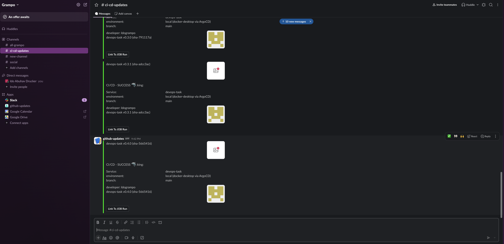
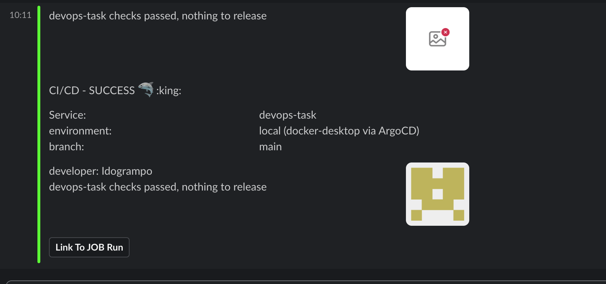
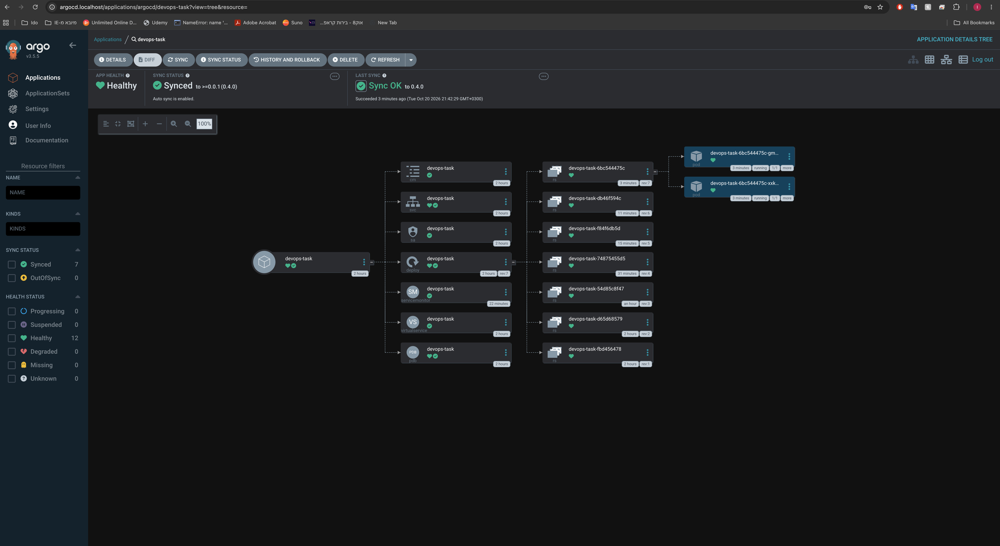
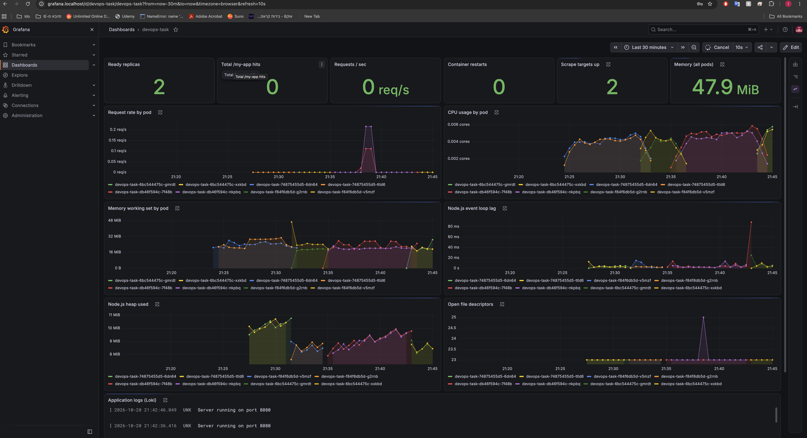
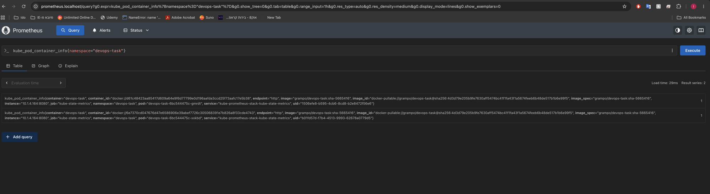
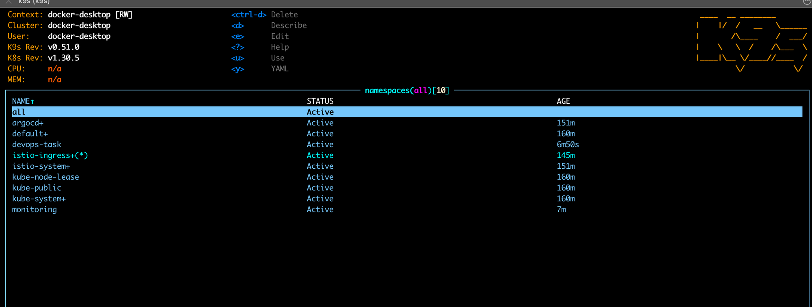
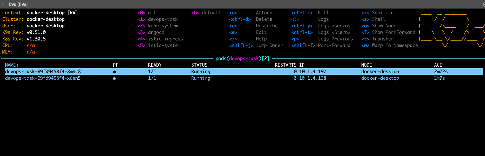
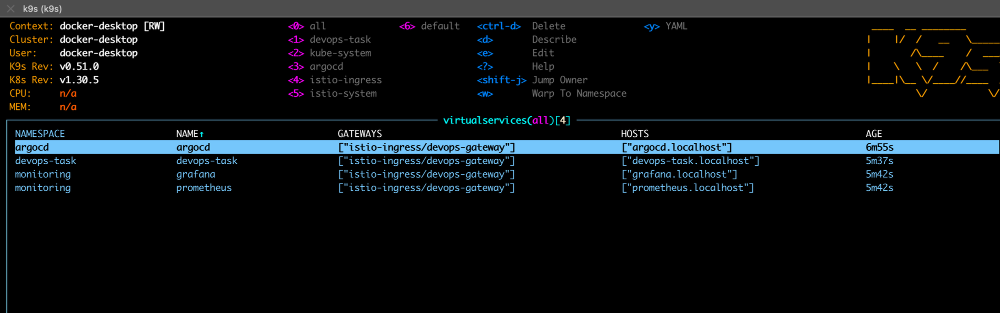
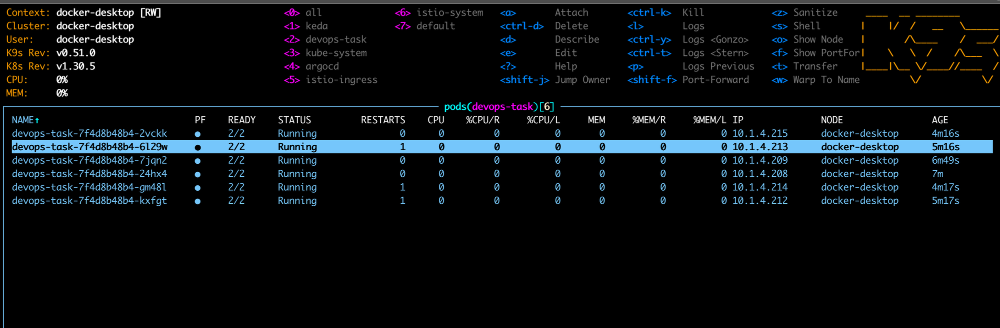
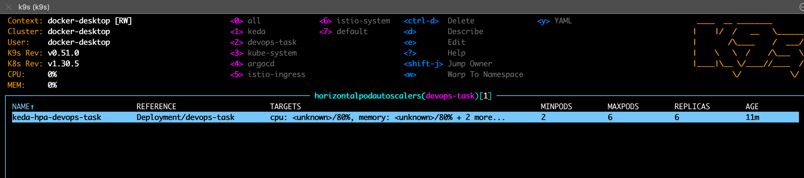

# DevOps Sample Node.js App

A small Express app with Prometheus metrics and health endpoints, packaged as a Docker image and Helm chart, built and scanned by GitHub Actions, and deployed to Kubernetes by ArgoCD.

| Path | Purpose | Exposed through the gateway |
|---|---|---|
| `/my-app` | Hello World, increments `root_access_total` | yes |
| `/about` | Static text | yes |
| `/ready`, `/live` | Readiness and liveness probes | no |
| `/metrics` | Prometheus metrics | no |
| `/classified` | Sample "do not expose" route | no |

## Repository layout

| Path | Contents |
|---|---|
| `app.js`, `test/` | The app and its smoke tests (`npm test`) |
| `Dockerfile` | Multi-stage build, non-root user, npm removed from the final image |
| `helm/devops-task/` | Helm chart |
| `.github/workflows/cicd.yml` | CI/CD pipeline |
| `actions/send_slack/` | Slack notification action (incoming webhook) |
| `pulumi/` | Pulumi program that installs the platform (Istio, ArgoCD, monitoring, KEDA, metrics-server) and applies the Application manifest |
| `argocd/` | The ArgoCD `Application` manifest (GitOps source of truth for the app) |
| `monitoring/` | Grafana dashboard for the app (provisioned by Pulumi as a ConfigMap) |
| `scripts/` | `bootstrap.sh` and `teardown.sh` for a local cluster |

## Design decisions

**Deployment, not StatefulSet.** The app is stateless: replicas are interchangeable and need no stable identity, ordered startup or persistent storage. A Deployment with a rolling update (`maxUnavailable: 0`) fits.

**Helm chart.** Readiness, liveness and startup probes, resource requests and limits, a ConfigMap (with a checksum annotation so config changes roll the pods), an optional Secret, a Service, a PodDisruptionBudget and an optional HPA. Pods run as non-root with a read-only root filesystem and all capabilities dropped. Traffic enters through an Istio `VirtualService`; a plain `Ingress` template is included but disabled by default.

**GitOps: ArgoCD pulls manifests directly from the app repository** (option 2 of the two on offer). The `Application` (`argocd/application.yaml`) points at `helm/devops-task` on `main`, with the environment values in `helm/devops-task/values-local.yaml`. I chose it over a separate GitOps repository because this is a single service: one repository means one set of access rules, one pull request for a code and chart change together, and nothing to keep in sync. The trade-off is that deploy commits share history with code, which is fine here and is why the bot commit below carries `[skip ci]`. Git is the source of truth for what runs: after each image build CI commits the new `image.tag` to `values-local.yaml`, ArgoCD notices the commit (polling every 3 minutes by default) and syncs it, and a rollback is a `git revert`. ArgoCD auto-syncs with `prune` and `selfHeal`, so manual changes in the cluster are reverted.

**Pulumi only bootstraps.** It installs the platform: Istio (base, istiod, ingress gateway) and a `Gateway`, ArgoCD, the monitoring stack, KEDA and metrics-server. It then applies the one `Application` manifest from Git. After that, every app deploy is a commit that ArgoCD syncs. The stack is pinned to the `docker-desktop` context and refuses any other, and its state lives in a local file backend (`~/.pulumi-local`).

**Git workflow: trunk-based.** Pull requests run every gate but publish nothing. Pushes to `main` publish and release.

## Monitoring

Installed by the same Pulumi stack, sized for a laptop (no Alertmanager, 6 h of metrics, 24 h of logs, nothing persisted).

- **Metrics:** kube-prometheus-stack (Prometheus, Grafana, kube-state-metrics). The chart ships a `ServiceMonitor` (enabled by the ArgoCD `Application`), so Prometheus scrapes `/metrics` inside the cluster even though the gateway does not expose it.
- **Logs:** Loki in single-binary mode, fed by Grafana Alloy, which tails every pod's logs through the Kubernetes API (no hostPath mounts, so it works on Docker Desktop).
- **Dashboard:** `devops-task` in Grafana: ready replicas, request rate and total hits (`root_access_total`), CPU, memory, restarts, Node.js event loop lag, heap and open file descriptors, plus a live log panel. Grafana loads it from a ConfigMap labelled `grafana_dashboard=1`.
- **Access:** http://grafana.localhost (user `admin`, password `admin`, local only; override with `pulumi config set --secret grafanaAdminPassword ...`) and http://prometheus.localhost, both through the Istio gateway.

## CI/CD pipeline

Runs on GitHub-hosted runners (`ubuntu-latest`).

**What triggers it.** Only changes that can affect the artifacts: `app.js`, `package*.json`, `Dockerfile`, `.dockerignore`, `test/`, `helm/`, `actions/` and the workflow itself. README, docs, Pulumi, monitoring and script changes do not run the pipeline.

**What gets rebuilt.** The image tag is `sha-<last commit that changed an image input>`, so a chart-only change reuses the existing image. If that tag is already on Docker Hub, build, scan and push are skipped. A new OCI chart release is published only when the image inputs or `helm/` changed; otherwise the run just re-checks tests and security gates. Chart-only edits need no CI deploy at all: ArgoCD sees the commit directly.

1. **Lint and test**: `npm test`, `helm lint`, `helm template`.
2. **SAST**: Semgrep (JavaScript, Node.js and Dockerfile rules); fails on any ERROR finding. `npm audit` fails on critical advisories.
3. **Version**: SemVer from the last `vX.Y.Z` tag. A `feat` commit bumps minor, `!:` or `BREAKING CHANGE` bumps major, anything else bumps patch. Pull requests get a throwaway `0.0.0-pr<N>` that is never published.
4. **Build and scan**: build the image, then Trivy; any fixable HIGH or CRITICAL finding fails the job and blocks everything after it.
5. **Push** (only on `main`): multi-arch image (`linux/amd64,linux/arm64`) tagged `sha-<commit>`.
6. **Deploy via Git**: CI commits the new tag to `helm/devops-task/values-local.yaml` (`[skip ci]`); ArgoCD does the rollout. The pipeline never touches the cluster.
7. **Release and notify**: the Helm chart is also pushed as a versioned OCI artifact to Docker Hub with a GitHub release `v<version>` (a release artifact; the cluster does not pull it), and a Slack message goes out through `actions/send_slack`.

Repository secrets: `DOCKER_HUB_TOKEN` (read and write) and `SLACK_WEBHOOK`. The Docker Hub namespace is set in the workflow `env` block. The `gitops` job needs the default `GITHUB_TOKEN` to be able to push to `main` (Settings, Actions, Workflow permissions), and branch protection on `main` would block it.

## Run it locally

Prerequisites:

- Docker Desktop with Kubernetes enabled (the `docker-desktop` context) and **at least 12 GB of memory and 6 CPUs** allocated to it (Settings, Resources). The full stack (Istio, ArgoCD, Prometheus, Grafana, Loki, KEDA and the app with sidecars) uses about 6.5 GB at idle. On an 8 GB VM it runs but sits at about 90% memory, and under load probes time out and pods restart.
- A macOS or Linux terminal with `bash` and `curl`. The scripts do not run in native Windows (PowerShell or `cmd`). On Windows use WSL2 with Docker Desktop's WSL integration enabled and run the scripts from inside WSL; this is untested.

Nothing else is needed; the script installs kubectl, Node.js 20+ and Pulumi if they are missing. It has only been run on macOS (Apple Silicon).

```sh
./scripts/bootstrap.sh            # install, deploy, wait until the app answers
./scripts/bootstrap.sh --dry-run  # pulumi preview only
./scripts/bootstrap.sh --reset    # forget old Pulumi state, e.g. after wiping the cluster
./scripts/teardown.sh             # remove everything
```

When it finishes:

- App: http://devops-task.localhost/my-app
- ArgoCD: http://argocd.localhost (user `admin`, password printed by the script)
- Grafana: http://grafana.localhost (user `admin`, password `admin`) and Prometheus: http://prometheus.localhost

The first run pulls a lot of images and takes several minutes. The gateway uses `localhost:80`, so that port must be free. The Docker Hub repository and this GitHub repository are public, so the cluster needs no credentials; a private setup would need an ArgoCD repository credential and an image pull secret.

## Access (local cluster)

| Service | URL | Login |
|---|---|---|
| App | http://devops-task.localhost/my-app | none |
| App, about page | http://devops-task.localhost/about | none |
| ArgoCD | http://argocd.localhost | `admin` / initial admin secret, see below |
| Grafana | http://grafana.localhost | `admin` / `admin` |
| Prometheus | http://prometheus.localhost | none |
| Repository | https://github.com/Idogrampo/devops-task | |
| CI/CD runs | https://github.com/Idogrampo/devops-task/actions | |
| Docker Hub (image and chart) | https://hub.docker.com/r/grampo/devops-task | |

The ArgoCD password is generated per cluster. `bootstrap.sh` prints it, or read it with:

```sh
kubectl --context docker-desktop -n argocd get secret argocd-initial-admin-secret -o jsonpath='{.data.password}' | base64 -d
```

The Grafana password is a local-only default; override it with `pulumi config set --secret grafanaAdminPassword <value>`. `/metrics`, `/classified`, `/ready` and `/live` are deliberately not routed by the gateway (404 from outside the cluster).

**Logs:** the dashboard has a live log panel. For ad-hoc queries, open Grafana, then Explore, pick the **Loki** datasource and run `{namespace="devops-task"}`, or `{namespace="devops-task"} | json | path="/my-app"` to filter the JSON access log.

## Screenshots

**CI/CD notification in Slack**



**Slack message for a change that needs no build (checks pass, nothing is released)**



**ArgoCD: application synced and healthy**



**Grafana: `devops-task` dashboard**



**Prometheus**



**Cluster after a fresh `bootstrap.sh` (k9s): namespaces**



**k9s: app pods in `devops-task`**



**k9s: Istio VirtualServices for the app, ArgoCD, Grafana and Prometheus**



**KEDA scale-out under load: 6 replicas, each with the Istio sidecar (2/2)**



**The HPA that KEDA manages for the app (2 to 6 replicas)**



## Local development

```sh
npm ci
npm test
PORT=8080 node app.js
```

## Tested on

macOS (Apple Silicon) with Docker Desktop and its built-in Kubernetes (v1.30). Linux is expected to work but has not been tested, and Windows is only expected to work through WSL2 (see Prerequisites).
